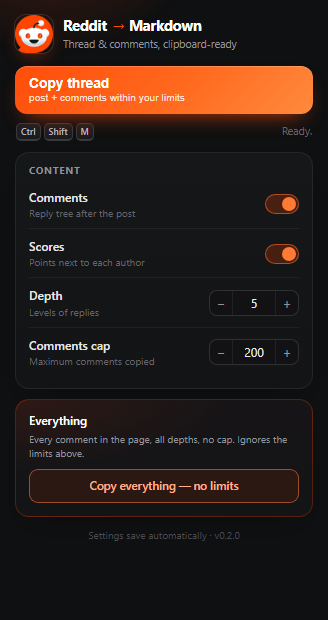

# Reddit → Markdown

A Chrome (Manifest V3) extension that turns the Reddit thread you are reading
into clean Markdown on your clipboard — post header, body, and comments with
their nesting preserved.



## Two ways to copy

| | |
|---|---|
| **Copy thread** | Post + comments, respecting the limits you set: include/exclude comments, max depth, max comments. Good for saving a useful link with its best replies. |
| **Copy everything — no limits** | *Expands the thread first* (clicks every "N more replies" / "view more comments" and scrolls to load the next batch), then copies every comment at every depth, with scores. No cap. |

Both are also available from the right-click menu, and **Ctrl+Shift+M**
(⌘⇧M on macOS) runs the normal copy on the active tab.

## What the output looks like

```markdown
---
title: "Post title"
subreddit: "r/programming"
author: "u/someone"
url: "https://www.reddit.com/r/programming/comments/abc123/post_title/"
date: "2026-10-28"
score: 1420
---

Post body, converted from Reddit's HTML to **Markdown** with images, links,
lists and fenced code blocks intact.

## Comments

> **u/commenter** · 512 points
>
> Top-level comment text, quoted once.

> > **u/replier** · 88 points
> >
> > A nested reply, quoted twice — blockquote depth equals nesting depth.
```

Dates are normalised to `YYYY-MM-DD`, frontmatter strings are escaped, and
scores are omitted when the option is off.

## Install

1. Download or clone this repository.
2. Open `chrome://extensions` (or `brave://extensions`).
3. Enable **Developer mode**.
4. **Load unpacked** → select this folder.
5. Open a Reddit thread.

## Options

| Option | Default | Meaning |
|---|---|---|
| Include comments | on | Append the reply tree |
| Include scores | on | Print `· N points` next to each author |
| Depth | 5 | Maximum nesting level kept (1–20) |
| Comments cap | 200 | Maximum number of comments kept (1–2000) |

Options save automatically to `chrome.storage.sync` and are ignored by
**Copy everything**, which always takes the whole page.

## How it works

```
popup / context menu / shortcut
        │  { type: "COPY_THREAD", all: true|false }
        ▼
content.js ──► expandAll()  (only for "everything")
        │         │  click "N more replies" / "view more comments"
        │         │  scroll to the end, wait for the DOM to go quiet
        │         │  repeat until nothing is left (max 90 s / 600 clicks)
        ▼
extractor (new UI | old.reddit)
        │  metadata from shreddit-* attributes, body via Turndown + GFM
        ▼
Markdown (YAML frontmatter + post + nested comments)
        ▼
navigator.clipboard.writeText()  → textarea + execCommand fallback
```

Notable choices:

* **Selector-based extraction, not Readability.** Readability flattens the
  comment tree; we need the structure. Selectors live in one `SELECTORS` block
  per extractor, with attribute → DOM-text fallbacks.
* **Shadow DOM aware.** Reddit's new UI is built from web components, so every
  query goes through `deepQuery`/`deepQueryAll`, which recurse into open shadow
  roots.
* **Expansion is text-driven.** Buttons are found by label (`"12 more replies"`,
  `"view more comments"`, `"load more comments"`) rather than brittle classes,
  so it survives Reddit redesigns.
* **No accidental navigation.** Clicks on "load more" anchors are guarded with
  `preventDefault()` so Reddit's own AJAX handler runs without leaving the page,
  and "continue this thread" links are never clicked.
* **Clipboard fallback.** If the async clipboard API is blocked without focus,
  a hidden textarea plus `execCommand("copy")` is used.
* **In-page feedback.** A small toast confirms the copy or explains the failure;
  it is created with inline styles so Reddit's CSP cannot break it.

## Limitations

* Reddit renders comments in batches. **Copy everything** expands them
  automatically, but branches that Reddit only exposes through a separate
  "continue this thread" page are counted and reported as *"N deep branches
  skipped"* rather than silently dropped.
* Comments that Reddit itself hides behind login or age gates cannot be read.
* Extraction depends on Reddit's markup. If Reddit ships a large redesign, the
  selectors in `extract-new.js` / `extract-old.js` are the only place to update.
* Targets `reddit.com`, `www.reddit.com` and `old.reddit.com` thread pages.

## Project layout

```
manifest.json       MV3 manifest, commands, content-script order
background.js       context menu (both modes) + keyboard command router
extract-new.js      shreddit extractor + shadow-DOM helpers
extract-old.js      old.reddit.com extractor
content.js          Markdown assembly, clipboard, toast, messages
expand.js           the load-more sweep used by "copy everything"
popup.html/css/js   options UI, copy buttons, steppers, status line
vendor/             Turndown 7.2.0 + turndown-plugin-gfm 1.0.2 (vendored)
test/expand-harness.html   browser harness for expand.js
icons/              16 / 48 / 128 px (Reddit favicon)
docs/popup.png      screenshot used above
```

## Verified

* `node --check` on all scripts (including the vendored UMD files); manifest
  parses; every referenced asset exists.
* Markdown assembly executed in Node: a 3-level thread produces exactly 1/2/3
  blockquote markers, scores and YAML escaping included.
* `test/expand-harness.html` executed in headless Chromium: every load-more
  control was clicked, all comments materialised, the "continue this thread"
  link was never touched, and the skipped-branch count was reported.
* No browser run against live Reddit from this environment (the API and the site
  block the test IP), so treat the selectors as assumptions until you open a
  real thread.

## License

MIT
